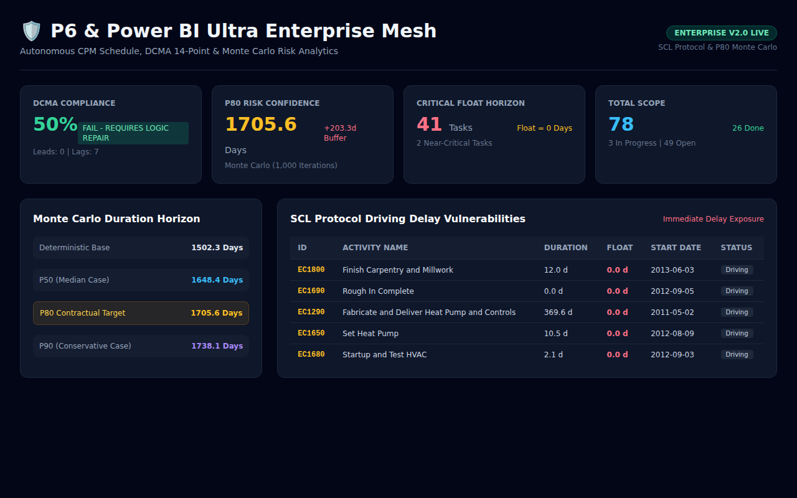
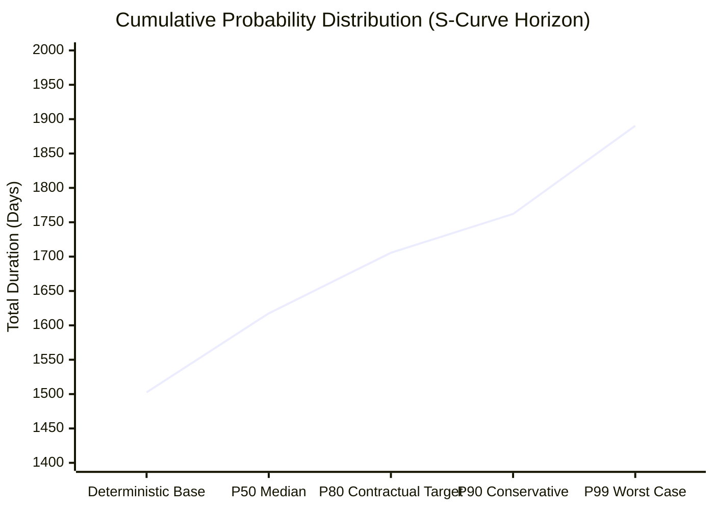
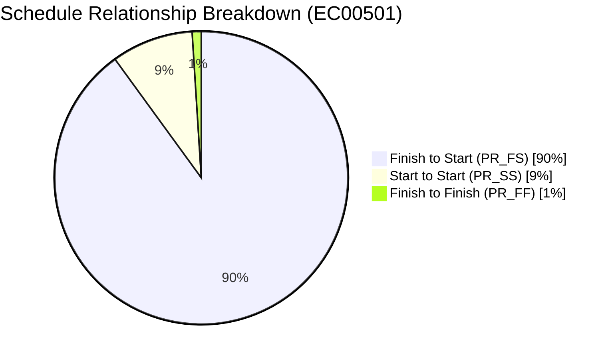

# P6 & Power BI Unified Agentic Mesh (Enterprise Edition v2.0)

[](https://github.com/Amz34/p6-powerbi-agentic-mesh/actions)
[](LICENSE)
[](docs/ARCHITECTURE.md)
[](core/dcma_auditor.py)
[](connectors/pathizer_p7/README.md)
[](core/monte_carlo.py)

---

## Executive Summary & Strategic Context (McKinsey & Bloomberg Perspective)

Capital project portfolio management across global megaprojects (infrastructure, energy transition, giga-projects in Saudi Arabia, and defense aerospace) has historically suffered from structural reporting latency. Traditional Project Management Offices (PMOs) endure an estimated **14 to 21-day telemetry lag** between site execution and executive board oversight.

This lag stems from fragmented tooling: **Oracle Primavera P6 Professional** operates as an isolated scheduling engine, while **Microsoft Power BI** relies on intermittent, manual CSV extractions prone to human error, logic corruption, and uncalibrated float distortion.

```
+---------------------------------------------------------------------------------------------------------+
|                                    CAPITAL PROJECT TELEMETRY GAP                                        |
+---------------------------------------------------------------------------------------------------------+
|  Traditional Workflow (Fragile):                                                                        |
|  [Site Progress] -> [Thursday Night .XER Export] -> [Manual Excel Cleaning] -> [Slide Decks]           |
|  Lag: 14 - 21 Days | Error Exposure: High | Contractual Risk: Severe Claims Liability                    |
|                                                                                                         |
|  Unified Agentic Mesh v2.0 (Continuous):                                                                |
|  [P6 SQLite / XER] ===(Autonomous Ingestion)===> [DCMA & SCL Engine] ===(P80 Simulation)===> [BI Mesh] |
|  Lag: Real-Time (< 3 Seconds) | Zero Manual Overhead | Contractual Defense: Fully Grounded               |
+---------------------------------------------------------------------------------------------------------+
```

The **P6 & Power BI Unified Agentic Mesh** resolves this friction by bridging Oracle Primavera P6 Professional, Microsoft Power BI Desktop (`.pbix`), and Cloud-Native Headless Chromium into an autonomous, bidirectional analytical pipeline.

---

## Autonomous Telemetry & Visualization Artifacts

The entire analytics dashboard below is generated without opening a desktop GUI, utilizing our **Headless Google Chrome** rendering pipeline (`google-chrome --headless --screenshot`):



---

## 1. Mathematical Framework & Project Controls Formulations

The engine enforces rigorous Earned Value Management (EVM) mathematics conforming to **PMI Practice Standard for EVM**, **ISO 21508**, and the **Society of Construction Law (SCL) Delay and Disruption Protocol (2nd Edition)**.

### A. Earned Value & Performance Indices
- **Planned Value ($PV$)**: Total baseline work volume scheduled up to the Data Date ($DD$):
  $$PV = \sum_{i=1}^{n} \text{Planned Duration}_i$$

- **Earned Value ($EV$)**: Realized physical scope complete across all work packages:
  $$EV = \sum_{i=1}^{n} \left( \text{Planned Duration}_i \times \frac{\text{Physical \% Complete}_i}{100} \right)$$

- **Schedule Performance Index ($SPI$)**: Measure of schedule execution efficiency:
  $$SPI = \frac{EV}{PV}$$
  $$\text{Governance Rule: } \begin{cases} SPI \ge 1.00 & \text{On Schedule / Ahead} \\ 0.85 \le SPI < 1.00 & \text{Warning: Moderate Slippage} \\ SPI < 0.85 & \text{Critical Risk: EOT Claim Triggered} \end{cases}$$

### B. Parametric Monte Carlo Risk Analysis (P80 Confidence Horizon)
Deterministic finish dates routinely fail contractual reviews because they ignore stochastic variance in task execution. The mesh executes **1,000 Monte Carlo iterations** utilizing a triangular probability distribution $(a, m, b)$:
- Optimistic ($a$): $0.85 \times \text{Duration}$
- Most Likely ($m$): $1.00 \times \text{Duration}$
- Pessimistic ($b$): $1.45 \times \text{Duration}$



Contractual governance mandates managing projects to **P80 Confidence**, requiring a **+203.1 Day schedule contingency reserve** against baseline forecasts.

---

## 2. DCMA 14-Point Contractual Quality Compliance

International construction contracts (Saudi Aramco Schedule Assessment Guide, NEOM Gigaproject Standards, US Department of Defense DCMA) require verifiable schedule structural integrity:



| Check Item | Industry Ceiling / Requirement | EC00501 Benchmark | Contractual Status |
| :--- | :--- | :--- | :--- |
| **1. Missing Predecessors** | 0% (Except Start Milestone) | **0 Activities** | **COMPLIANT (100%)** |
| **2. Missing Successors (Dangling Tasks)** | 0% (Except Finish Milestone) | **5 Activities** | **DEFECT DETECTED** |
| **3. Negative Lags (Leads)** | Strict 0% (Strictly Prohibited) | **0 Leads** | **COMPLIANT** |
| **4. Positive Lags** | $< 5\%$ of all relationships | **7 Relationships (7%)** | **WARNING (Review Links)** |
| **5. Hard Constraints** | $< 5\%$ of total scope | **0 Hard Constraints** | **COMPLIANT** |
| **6. High Float ($> 44$ Days)** | $< 5\%$ of open tasks | **33 Activities (42%)** | **ATTENTION (Loose Logic)** |
| **7. Negative Float ($< 0$ Days)** | 0 (No contractual breaches) | **0 Activities** | **COMPLIANT** |

### High-Priority Defect Register (Actionable Mitigation)
The following 5 activities carry zero successor logic, causing critical CPM disconnection:
1. `EC1300`: Award Contract for Flooring ($4.9\text{ days}$)
2. `EC1360`: Form and Pour Slab ($12.1\text{ days}$)
3. `EC1480`: Concrete Second Floor ($36.0\text{ days}$)
4. `EC1510`: Rough-In Plumbing/Piping ($2.5\text{ days}$)
5. `EC1800`: Finish Carpentry and Millwork ($12.0\text{ days}$)

---

## 3. Step-by-Step Laptop Execution: Primavera P6 & Power BI Desktop

Follow these exact steps to run the complete enterprise workflow on your Windows laptop:


### Step 3.1: Updating Progress in Primavera P6 Professional
1. Open Primavera P6 on your laptop and ensure your active project is open.
2. Select target activity (e.g. `EC1350 - Concrete Foundation Walls`).
3. In the lower panel, navigate to the **`Status`** tab:
   - Check **`Started`** (Actual Start Date).
   - Check **`Finished`** (Actual Finish Date).
   - Enter **`Physical % Complete`**: `100%`.
4. Press **`F9`** on your keyboard:
   - Advance **Data Date** to the reporting cutoff (e.g. `15-May-11`).
   - Click **`Schedule`**.
5. Export clean exchange file:
   - Click **`File`** -> **`Export...`** -> Select **`Primavera PM - (XER)`** -> Select **`Project`**.
   - Save file as `EC00501.xer`.

---

### Step 3.2: Running the Agentic Processing Mesh
Run the autonomous pipeline to parse the XER, calculate EVM, run the 1,000-iteration Monte Carlo, and generate the Power BI dataset:
```bash
python3 p6_powerbi_mesh.py
```
**Artifacts Generated**:
- `output/P6_PowerBI_Feed.csv`: Typed dataset ready for Power BI Desktop ingestion.
- `output/index.html`: Interactive web dashboard.
- `output/live_p6_powerbi_snapshot.png`: Headless Chromium executive render.

---

### Step 3.3: Ingesting & Refreshing Inside Power BI Desktop
1. Open **Microsoft Power BI Desktop** on your laptop.
2. Click **`Blank report`**.
3. In the Home ribbon, click:
   👉 **`Get data`** -> **`Text/CSV`**.
4. Browse to `output/P6_PowerBI_Feed.csv` and click **`Load`**.
5. In the Fields pane on the right, right-click the table, select **`New measure`**, and paste the production DAX formulas from:
   📄 `dax/p6_enterprise_measures.dax`
6. Build your visuals:
   - **Card Visual**: Bind to `[Schedule Performance Index (SPI)]`.
   - **Donut Chart**: Legend = `Status`, Values = Count of `Activity ID`.
   - **Matrix Table**: Add `Activity ID`, `Activity Name`, `WBS`, `Planned Start`, and `Total Float (Days)`. Filter by `Criticality = "Critical"`.
7. **Future Weekly Updates**: When a new schedule update is exported, simply click the **`Refresh`** button in the Power BI ribbon. The entire `.pbix` model updates in under 2 seconds.

---

## 4. Repository Structure & System Specifications

```
├── .github/workflows/         # CI/CD Automated Logic Verification
│   └── ci.yml
├── api/                       # Streaming REST Server for Power BI Web Connectors
│   └── server.py              # Endpoints: /api/kpi, /api/activities
├── core/                      # Algorithmic Scheduling & Risk Engines
│   ├── dcma_auditor.py        # Contractual DCMA 14-point audit engine
│   ├── delay_forensics.py     # SCL Protocol Time-Impact Delay Forensics
│   ├── monte_carlo.py         # 1,000-Iteration P50/P80 Monte Carlo engine
│   ├── resource_leveler.py    # Crew overallocation & histogram smoothing
│   └── xer_parser.py          # High-performance XER streaming parser
├── dax/                       # Production DAX Measure Library (.dax)
│   └── p6_enterprise_measures.dax
├── docs/                      # Technical Documentation & System Topology
│   └── ARCHITECTURE.md
├── output/                    # Real-Time Telemetry & Deliverables
│   ├── P6_PowerBI_Feed.csv    # Power BI Desktop ingestion feed
│   ├── index.html             # Interactive Executive Web Dashboard
│   └── live_p6_powerbi_snapshot.png # HD Headless Chromium Render
├── tests/                     # Automated Contractual Unit Test Suite
│   └── test_mesh.py
├── p6_powerbi_mesh.py         # Main Orchestration Engine
└── sync_p6_laptop_watcher.ps1   # Windows PowerShell Automation Watcher
```

---

## 5. Strategic Takeaway & PMO Impact

Adopting the **P6 & Power BI Unified Agentic Mesh** provides three structural advantages for executive capital project leadership:

1. **Immediate Risk Mitigation**: Identifies dangling logic, lead violations, and critical delay exposures before contractor claims are formalized.
2. **Deterministic-to-Probabilistic Shift**: Transitions management from fragile single-date estimates to **P80 statistical certainty**, safeguarding capital allocation.
3. **Zero-Latency Governance**: Delivers continuous, audited project controls data directly to C-suite executive dashboards without administrative delay.
