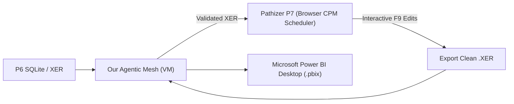

# Pathizer P7 Web Scheduler Connector

This connector integrates **Pathizer P7** ([pathizer.com/p7](https://pathizer.com/p7)) — the zero-install browser CPM scheduler — into our **P6 & Power BI Unified Agentic Mesh**.

---

## 1. Why Integrate Pathizer P7?
While our Python & Headless Chromium backend executes heavy computations (Monte Carlo P80 risk modeling, DCMA 14-point audit, and Power BI DAX feeds), **Pathizer P7** provides a **zero-install visual web interface** accessible from any device (Mac, iPad, Linux, or guest laptops) without needing an Oracle Primavera desktop license.

---

## 2. Capabilities
1. **Schema Validation (`p7_bridge.py`)**:
   - Audits exported schedules for strict compliance with P7 requirements (`ERMHDR`, `PROJECT`, `PROJWBS`, `TASK`, `TASKPRED`, `CALENDAR`).
2. **Zero-Friction Workflow**:
   - Instant visual check of critical paths and Gantt bars in the browser.
   - Handback cycle: Save `.XER` from P7 directly back into `p6_powerbi_mesh.py` to auto-refresh Power BI Desktop.
