# Enterprise Architecture Specification: P6-PowerBI Agentic Mesh

## 1. System Topology
The P6-PowerBI Agentic Mesh provides end-to-end synchronization between Primavera P6 Professional, Microsoft Power BI Desktop, and cloud-native headless telemetry.

```mermaid
flowchart TD
    subgraph Windows Client
        P6["Oracle Primavera P6 Professional"] -->|"Export (.XER / SQLite)"| Watcher["PowerShell Watcher (sync_p6_laptop_watcher.ps1)"]
        Watcher -->|"Data Feed"| PBI["Microsoft Power BI Desktop (.pbix)"]
    end

    subgraph Agentic Linux VM Infrastructure
        P6In["P6 Ingestion Engine (core/xer_parser.py)"] --> SQLite[("High-Perf SQLite Cache")]
        SQLite --> DCMA["DCMA 14-Point Assessment (core/dcma_auditor.py)"]
        SQLite --> EVM["EVM Calculator (SPI / CPI / S-Curve)"]
        EVM --> FeedGen["Power BI Feed Generator (CSV / JSON API)"]
        FeedGen --> Headless["Headless Chromium Renderer (google-chrome --headless)"]
        Headless --> Bot["Telegram Alerts (@AzGem_Bot)"]
        FeedGen --> REST["Streaming REST API (:8788)"]
    end

    Watcher <-->|"Bi-Directional Telemetry"| REST
```

## 2. EVM Mathematical Formulations
- **Schedule Performance Index (SPI)**: $\text{SPI} = \frac{\text{Earned Value (EV)}}{\text{Planned Value (PV)}}$
- **Cost Performance Index (CPI)**: $\text{CPI} = \frac{\text{Earned Value (EV)}}{\text{Actual Cost (AC)}}$
- **Estimated at Completion (EAC_t)**: $\text{EAC}_t = \frac{\text{Planned Horizon}}{\text{SPI}}$

## 3. Contractual Benchmarks
Enforces Saudi Aramco, NEOM, and US DoD DCMA guidelines:
- Negative lags (leads): Strict $0$ tolerance.
- Missing logic (open ends): $< 5\%$ contractual ceiling.
- High float activities ($> 44$ days): Strict categorization and risk flagging.
